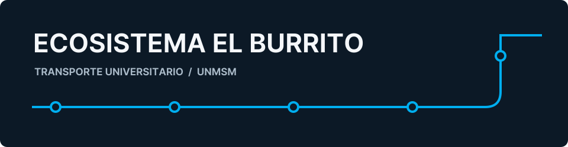
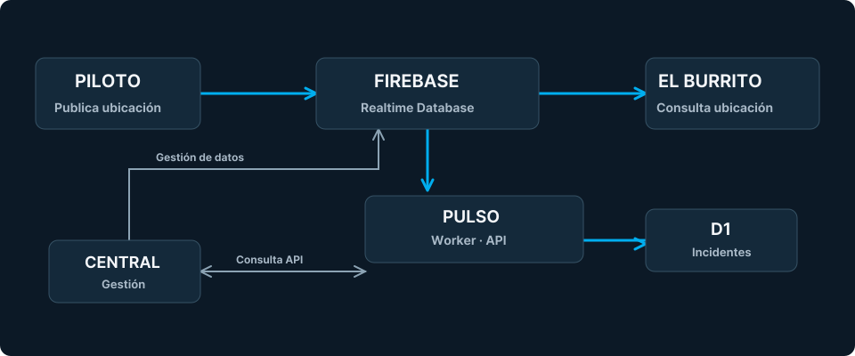

  <h1></h1>

  
Desarrollado por

  <picture>
    <source media="(prefers-color-scheme: dark)" srcset="docs/assets/well.gif">
    
  </picture>

  
El bus universitario de San Marcos, en tiempo real.

  
<a href="#user-content-aplicacion">Aplicación</a> · <a href="#user-content-ecosistema">Ecosistema</a> · <a href="#user-content-desarrollo">Desarrollo</a>

<h2 align="center">Aplicación</h2>

  
  
Consulta la ubicación del bus universitario en el mapa, junto con la ruta y sus paraderos.

  
<a href="User/README.md"><strong>Conocer El Burrito →</strong></a>

<h2 align="center">Ecosistema</h2>

<table align="center">
  <tr>
    <td align="center" width="33%">
       
      <strong>PILOTO</strong> 
      Operación del recorrido y transmisión de ubicación. 
      <a href="Driver/README.md">Aplicación de conductores →</a>
    </td>
    <td align="center" width="33%">
       
      <strong>CENTRAL</strong> 
      Gestión de conductores, buses y asignaciones. 
      <a href="AdminWeb/README.md">Panel administrativo →</a>
    </td>
    <td align="center" width="33%">
       
      <strong>PULSO</strong> 
      Monitoreo de las publicaciones de ubicación. 
      <a href="docs/architecture/pulso.md">Monitor operativo →</a>
    </td>
  </tr>
</table>

<h2 align="center">Arquitectura</h2>

  
  
PILOTO publica la ubicación en Firebase y El Burrito la consulta. PULSO observa las publicaciones y registra incidentes; CENTRAL gestiona datos y consulta el monitor.

  
<a href="docs/architecture/overview.md">Explorar la arquitectura →</a>

<h2 align="center">Tecnologías</h2>

<table align="center">
  <tr>
    <td align="center" width="33%"> <strong>React Native</strong> Aplicaciones móviles</td>
    <td align="center" width="33%"> <strong>React</strong> Interfaz administrativa</td>
    <td align="center" width="33%"> <strong>TypeScript</strong> Lenguaje de desarrollo</td>
  </tr>
  <tr>
    <td align="center"> <strong>Firebase</strong> Identidad y datos en tiempo real</td>
    <td align="center"> <strong>Mapbox</strong> Mapa y visualización de ruta</td>
    <td align="center"> <strong>Cloudflare</strong> Worker y almacenamiento de PULSO</td>
  </tr>
</table>

<h2 align="center">Monorepo</h2>

<table align="center">
  <tr><td> <a href="User/README.md"><code>User/</code></a></td><td>Aplicación para estudiantes</td></tr>
  <tr><td> <a href="Driver/README.md"><code>Driver/</code></a></td><td>Aplicación para conductores</td></tr>
  <tr><td> <a href="AdminWeb/README.md"><code>AdminWeb/</code></a></td><td>Panel administrativo</td></tr>
  <tr><td> <a href="AdminWeb/monitor/"><code>AdminWeb/monitor/</code></a></td><td>Monitor de seguimiento</td></tr>
  <tr><td> <a href="FirebaseLab/README.md"><code>FirebaseLab/</code></a></td><td>Laboratorio local de permisos de Firebase</td></tr>
  <tr><td> <a href="docs/"><code>docs/</code></a></td><td>Documentación compartida</td></tr>
  <tr><td> <a href="scripts/"><code>scripts/</code></a></td><td>Utilidades del equipo</td></tr>
</table>

<h2 align="center">Documentación y desarrollo</h2>

<table align="center">
  <tr>
    <td align="center" width="50%">
      <strong>Ingeniería</strong> 
      <a href="docs/architecture/overview.md">Arquitectura</a> ·
      <a href="docs/adr/README.md">Decisiones</a> ·
      <a href="docs/diagnostics/troubleshooting.md">Diagnóstico</a>
    </td>
    <td align="center" width="50%">
      <strong>Desarrollo</strong> 
      <a href="docs/engineering/onboarding.md">Incorporación</a> ·
      <a href="docs/engineering/workflow.md">Flujo de trabajo</a> ·
      <a href="docs/engineering/versioning-and-releases.md">Versionado</a>
    </td>
  </tr>
</table>

<a href="FirebaseLab/README.md">FirebaseLab</a> · <a href="docs/AGENTS.md#7-mapa-de-documentos">Mapa de documentación</a>

  
  
<strong>well.</strong>

